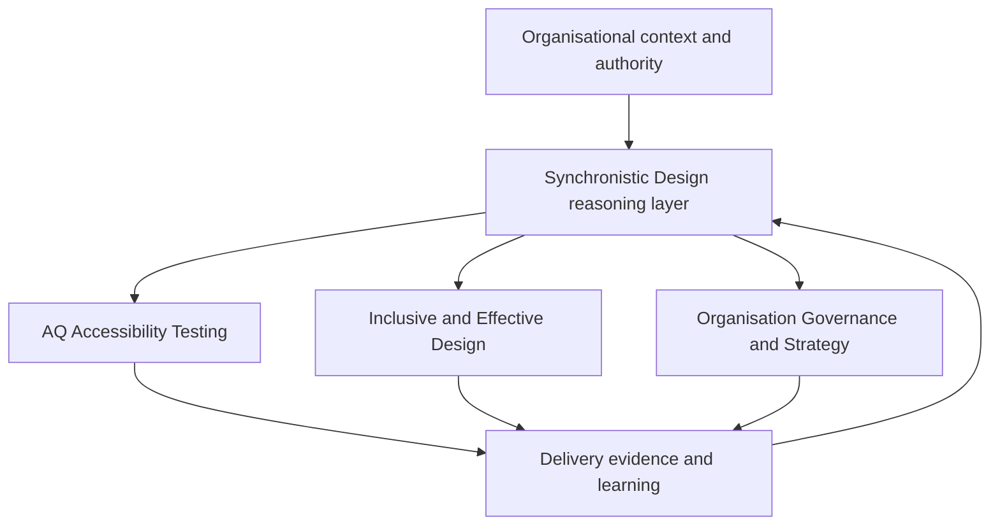

# Synchronistic Design Formal Operating Model

## Version 0.1 — High-level draft

## 1. Purpose

The Synchronistic Design Formal Operating Model provides a shared reasoning layer for aligning:

- an organisation's purpose, values and brand promises;
- customer and employee intentions, characteristics and contexts;
- product and service capabilities;
- design and interaction decisions;
- accessibility and quality evidence;
- governance, accountability and organisational learning.

It is intended to sit above, connect and route work between three specialist capability repositories:

1. **AQ Accessibility Testing**
2. **Inclusive and Effective Design**
3. **Organisation Governance and Strategy**

The model does not merge those repositories or duplicate their specialist content. It gives an organisation a consistent way to decide which capability is needed, what evidence should move between them, where alignment has been achieved and where accountable human judgement is required.

It can be used by people, assisted by an LLM, or managed through an authorised agentic workflow.

> **Synchronistic design aligns organisational promise, product capability, system behaviour and human context at the moments that matter.**

> **Equivalent experience ensures that this alignment is not reserved for the organisation's imagined default customer.**

---

## 2. Position in the wider system

The operating model is an **orchestration layer**, not a higher source of authority.

It connects organisational intent with specialist knowledge and delivery evidence. It must not override law, regulation, organisational policy, authorised human decisions or accountable risk ownership.

### Authority hierarchy

Where sources conflict, the following hierarchy applies:

1. applicable law and regulation;
2. formally adopted organisational policy and contractual obligations;
3. decisions made by authorised and accountable people;
4. approved organisational standards, controls and delivery frameworks;
5. evidence and guidance held in the specialist repositories;
6. interpretations, recommendations and generated outputs produced by an LLM.

The model may reveal contradictions within this hierarchy. It does not silently resolve them. Material conflicts must be recorded and escalated to the appropriate accountable owner.

---

## 3. Scope

The operating model governs the relationships between organisational intent, design decisions, delivery work, evidence and accountability.

It is designed to support:

- brand and value alignment;
- product and service planning;
- customer and user research;
- inclusive and effective design;
- design-system and pattern governance;
- engineering and content delivery;
- accessibility and quality testing;
- procurement and supplier assurance;
- release and exception decisions;
- operational monitoring and continuous improvement.

### The model is deliberately agnostic

It does not require:

- a particular design system or component library;
- a particular brand model, vocabulary or visual identity;
- a particular JavaScript framework, application architecture or testing platform;
- a particular project method, delivery lifecycle or ticketing system;
- a single accessibility standard as the complete definition of success.

Organisation-specific and technology-specific requirements should be connected through adapters, mappings or profiles. They should not be embedded in the core reasoning model.

### The model does not

- replace specialist design, research, engineering, testing or governance expertise;
- treat WCAG or another standard as the sole definition of an acceptable experience;
- certify legal compliance;
- infer lived experience without relevant human evidence;
- authorise policy exceptions or accept release risk;
- prescribe implementation code;
- require the three specialist repositories to use the same internal structure.

---

## 4. Core operating proposition

The operating model treats a product or service as a set of connected promises, capabilities, interactions and outcomes.

Its purpose is to maintain alignment between five elements:

| Element | Core question |
| --- | --- |
| Organisational intent | What has the organisation promised, required or chosen to value? |
| Human intention and context | What are people trying to achieve, and under what circumstances? |
| Product or service capability | What does the product or service enable? |
| Interaction behaviour | How can people understand, control and recover within the experience? |
| Evidence and accountability | What supports the claim, and who is responsible for the decision? |

An experience is not considered aligned merely because a task can be completed or a technical requirement has passed.

The model also considers effort, understanding, orientation, autonomy, privacy, recovery, predictability, confidence and equivalence where they are relevant to the intended outcome.

---

## 5. Shared assessment spine

The reasoning layer uses three connected assessment layers already reflected in the wider repository architecture.

| Assessment layer | Purpose | Typical lead capability |
| --- | --- | --- |
| 1. Scope and applicability | Establish what applies, why it applies, who may be affected and which authority governs the decision | Organisation Governance and Strategy |
| 2. Inclusive service outcomes | Define the experience, capability and equivalent outcomes that the product or service should provide | Inclusive and Effective Design |
| 3. Evidence, conformity and monitoring | Determine what has been demonstrated, how confidently it can be claimed and what must continue to be monitored | AQ Accessibility Testing |

This is a reasoning sequence, not a rigid delivery lifecycle. Work may begin in any layer and move between them as evidence changes.

The relationship is also not one-to-one. Each repository may contribute to all three layers. For example, testing evidence may reveal that the intended outcome was framed incorrectly; design research may change the applicable contexts; governance may require additional monitoring or a different evidence threshold.

The reasoning layer preserves these connections and records why work has moved between them.

---

## 6. The three connected capability repositories

### 6.1 AQ Accessibility Testing

**Primary role:** establish what can be tested, what evidence exists and how confident the organisation can be in claims about accessibility and experience quality.

This repository may contain:

- test requirements and acceptance conditions;
- automated, assisted and manual test methods;
- standards mappings;
- behavioural and interaction evaluation methods;
- evidence-quality rules;
- test records, findings and coverage gaps;
- monitoring and regression approaches.

It answers questions such as:

- What can be tested reliably?
- What requires human judgement?
- What evidence supports or contradicts an accessibility claim?
- Which contexts, interactions or outcomes have not been assessed?

Testing provides evidence. It does not independently decide product priority, policy, exceptions or acceptable organisational risk.

### 6.2 Inclusive and Effective Design

**Primary role:** translate intended human and organisational outcomes into inclusive design decisions, patterns, requirements and experience qualities.

This repository may contain:

- inclusive design principles and decision filters;
- customer characteristics, barriers and contexts;
- research and co-design methods;
- experience and interaction patterns;
- guidance for content, components and journeys;
- equivalence and outcome models;
- design review and contribution practices.

It answers questions such as:

- What should people be able to understand, control and achieve?
- Which barriers could be prevented through design?
- What would an equivalent experience require?
- Which assumptions require research or testing?

The repository can inform a design system without depending on a particular system, token structure or component technology.

### 6.3 Organisation Governance and Strategy

**Primary role:** connect inclusion and accessibility with organisational authority, values, risk, investment, ownership and continuous improvement.

This repository may contain:

- policies, commitments and strategic objectives;
- roles, decision rights and accountability models;
- risk and exception governance;
- maturity and capability models;
- procurement and supplier controls;
- measurement and reporting frameworks;
- change, learning and cultural practices;
- legal, regulatory and ethical context.

It answers questions such as:

- Who is accountable for the outcome?
- Which organisational promise, policy or risk threshold applies?
- Who may approve an exception or accept residual risk?
- How will evidence influence investment and improvement?

Governance should integrate with existing organisational systems rather than create a separate accessibility bureaucracy.

---

## 7. Organisational adapters

The core model remains stable. Each organisation connects its own systems through a small set of explicit adapters.

### Values and brand adapter

Translates organisational values and brand promises into observable experience propositions.

For example, a value such as independence should be connected to outcomes including user control, self-service, privacy, recoverability and access to an effective alternative when required.

The adapter does not redefine the brand. It asks what the brand commitment should mean in product and service behaviour.

### Governance and authority adapter

Maps the model to existing:

- boards, committees and steering groups;
- product and service ownership;
- risk, legal and compliance functions;
- design, engineering and quality governance;
- procurement and supplier management;
- release and exception authority.

### Delivery adapter

Maps the model to the organisation's existing lifecycle, whether that uses agile, continuous delivery, staged assurance, service design or another approach.

It identifies where required inputs, reviews, evidence and decisions enter the organisation's normal workflow.

### Technology adapter

Connects framework-neutral requirements to the technologies in use, including design systems, web or native frameworks, content platforms, testing tools and data services.

Technology-specific rules remain in the adapter or specialist implementation layer. They do not become universal principles.

### Evidence and measurement adapter

Maps the model to existing research repositories, analytics, customer feedback, test-management systems, operational measures, complaints, support data, risk reporting and performance dashboards.

It distinguishes what each evidence source can legitimately demonstrate.

---

## 8. The operating cycle

The model uses a continuous six-part reasoning cycle. The cycle can begin at any point when a material change, new product, finding or decision enters the system.

### 1. Orient

Establish the applicable organisational context:

- intended outcome;
- affected people and contexts;
- brand promises and values;
- policies, obligations and constraints;
- accountable owners;
- known evidence and uncertainty.

### 2. Frame

Express the issue as an alignment question rather than immediately treating it as a design defect, test failure or compliance problem.

The framing should identify:

- the human intention;
- the product or service capability involved;
- the expected interaction or experience outcome;
- possible barriers or differences in experience;
- the evidence needed to support a decision.

### 3. Route

Send the question to one or more specialist repositories.

- Route evaluation and evidence-confidence questions to **AQ Accessibility Testing**.
- Route experience, barrier and interaction questions to **Inclusive and Effective Design**.
- Route accountability, policy, investment, exception and risk questions to **Organisation Governance and Strategy**.

Most material questions will require more than one repository. Routing should preserve their distinct responsibilities rather than asking one repository to answer everything.

### 4. Evaluate

Compare requirements, design decisions, implementation evidence and human evidence.

Evaluation may use:

- applicable standards;
- expert review;
- automated and manual testing;
- qualitative research;
- quantitative research and analytics;
- customer feedback and support evidence;
- operational and business evidence.

No single source is assumed to answer every question.

### 5. Decide

Record what the evidence supports, what remains uncertain and who has authority to decide.

The reasoning layer may recommend an action. Accountable people retain responsibility for prioritisation, policy interpretation, exception approval and risk acceptance.

### 6. Learn

Return relevant evidence and decisions to the appropriate repositories and organisational systems.

Learning may update:

- requirements and patterns;
- test methods and coverage;
- research questions;
- organisational controls;
- training and guidance;
- risk and investment priorities;
- the assumptions used in future decisions.

---

## 9. Standard reasoning record

The reasoning layer should create or maintain a lightweight record for each material alignment question.

The record should contain:

| Field | Purpose |
| --- | --- |
| Alignment question | The question that needs to be answered |
| Organisational context | Applicable promise, value, policy, objective or obligation |
| Intended human outcome | What people need to understand, control or achieve |
| Relevant contexts | Characteristics, environments, technologies or situations that may affect the experience |
| Connected capabilities | The repositories and organisational systems involved |
| Evidence available | Sources that support, qualify or contradict the claim |
| Evidence gaps | What is missing or cannot yet be concluded |
| Current state | The controlled evidence or decision state |
| Required action | Research, design, implementation, testing, governance or monitoring work |
| Accountable owner | The person or role responsible for the decision |
| Review condition | Date, event, evidence threshold or change that requires reassessment |

This is a traceability record, not a substitute for detailed requirements, research reports, design files, test results or governance decisions.

---

## 10. Controlled states

Binary pass or fail decisions are insufficient for many experience questions. The model uses the following high-level states:

- **Supported** — sufficient relevant evidence supports the current claim.
- **Partially supported** — some evidence exists, with defined limitations or gaps.
- **Unsupported** — a claim has been made without adequate evidence.
- **Contradicted** — available evidence conflicts with the claim or intended outcome.
- **Not assessed** — no adequate evaluation has taken place.
- **Customer evidence required** — the question cannot be answered responsibly without research or feedback from relevant people.
- **Human decision required** — evidence is available, but the decision requires accountable judgement.
- **Exception active** — an authorised, time-bounded exception has been recorded with compensating action and review conditions.

These states describe evidence and governance. They must not be presented as certification.

---

## 11. Decision rights and escalation

The operating model separates evidence production, recommendation and accountable decision-making.

### Specialist capabilities may

- produce findings and evidence;
- assess confidence and coverage;
- identify barriers and experience differences;
- propose remediation or further investigation;
- identify policy or value conflicts.

### Product or service owners may

- prioritise work within their delegated authority;
- commission research, design, remediation and testing;
- recommend an exception or release decision;
- accept routine delivery decisions where policy permits.

### Authorised governance owners may

- interpret organisational policy;
- approve or reject material exceptions;
- accept residual risk within delegated thresholds;
- resolve conflicts between organisational priorities;
- require investment, monitoring or corrective action.

### Executive or enterprise authority is required when

- risk exceeds delegated thresholds;
- a decision conflicts with published values or commitments;
- a systemic barrier affects multiple products or services;
- legal, regulatory or contractual interpretation is material;
- remediation requires enterprise investment or policy change.

An exception record should include scope, affected people, uncertainty, disadvantage, compensating action, approver, monitoring, review date and expiry condition.

---

## 12. Role of an LLM or agentic system

An LLM can manage the reasoning process, but it does not become the accountable authority.

### The LLM may

- interpret and classify incoming questions;
- retrieve relevant knowledge from the three repositories;
- map organisational values to existing experience requirements;
- identify contradictions, missing evidence and uncovered contexts;
- create and maintain traceability between promises, requirements, designs, tests and decisions;
- propose research, design, testing or governance actions;
- monitor review conditions and changes;
- prepare evidence summaries for accountable people.

### The LLM must

- preserve source authority and provenance;
- distinguish evidence from inference;
- distinguish standards conformance from accessible or equivalent experience;
- retain uncertainty rather than filling gaps with plausible content;
- route questions to the correct specialist capability;
- escalate decisions outside its authority;
- record why a conclusion or recommendation was reached.

### The LLM must not

- invent customer evidence;
- treat synthetic personas as validation;
- make legal or certification claims;
- approve exceptions or accept organisational risk;
- override authorised policy or human decisions;
- infer that task completion proves equivalent experience;
- silently convert a technology-specific implementation into a universal rule.

---

## 13. Repository interface contract

Each connected repository should remain independently usable while exposing a small, consistent interface to the reasoning layer.

Each repository should declare:

- its purpose and boundaries;
- its authority and limitations;
- the questions it can answer;
- the inputs it requires;
- the outputs and evidence it produces;
- stable identifiers for canonical requirements or knowledge objects;
- evidence provenance and confidence;
- responsible owners or maintainers;
- escalation and human-review conditions;
- versioning and supersession rules.

The interface contract allows repositories to evolve independently without breaking the reasoning layer.

The reasoning layer should refer to canonical objects by stable identifiers rather than copy their full content. This reduces duplication and prevents conflicting versions from becoming embedded across repositories.

---

## 14. Minimum outputs

The operating model should be able to produce the following high-level outputs:

1. **Experience alignment profile** — the relevant promises, intended outcomes, contexts and measures for a product or service.
2. **Repository routing record** — which specialist capabilities were consulted and why.
3. **Evidence map** — the evidence available, its provenance, limitations and gaps.
4. **Alignment assessment** — the current controlled state for each material question.
5. **Action and ownership record** — required work, accountable owners and review conditions.
6. **Decision or exception record** — the authorised conclusion, conditions, compensating actions and expiry where applicable.
7. **Learning update** — knowledge that should change guidance, tests, governance or future decisions.

These outputs can be represented in Markdown, structured data, a work-management platform or an organisational governance system. The model defines their meaning, not their file format or software implementation.

---

## 15. Success criteria for the operating model

The model is working when it helps an organisation to:

- connect stated values with observable product and service behaviour;
- prevent important experience requirements from being lost between teams;
- distinguish conformance evidence from broader claims about experience;
- identify when equivalent experience has not been demonstrated;
- route questions to the appropriate specialist knowledge;
- make uncertainty and missing evidence visible;
- preserve accountable human decision-making;
- learn from research, testing, complaints, support and operational outcomes;
- improve existing delivery and governance systems rather than create a parallel process.

Its success should not be measured by the number of records, reviews or principles applied.

The useful question is whether the organisation is better able to keep its promises, products and decisions in step with the people it serves.

---

## 16. Recommended next design layer

This high-level model should remain stable and implementation-agnostic.

The next layer should define:

- the canonical reasoning schema;
- principle-to-repository routing rules;
- evidence types and confidence rules;
- escalation triggers and decision thresholds;
- the minimum metadata exchanged between repositories;
- reusable templates for alignment, evidence, decision and exception records;
- the agent instructions required to operate the model safely.

Those operational specifications should be maintained separately from this document so that organisations can adopt the core model without adopting a particular design system, brand framework, technology stack or delivery method.
